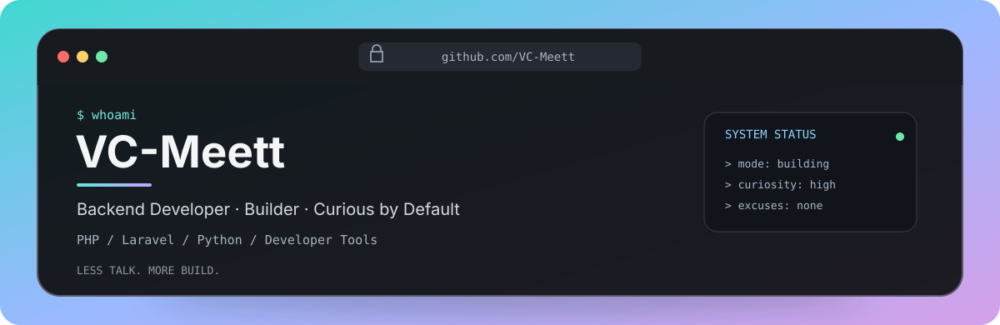

### `VC-Meett@github:~$`

**Backend Developer · Builder · Curious by Default**

Building useful things, automating the boring parts, and turning experiments into tools.

---

### `cat about.txt`

- Backend-focused developer working with **PHP, Laravel, and Python**.
- Interested in developer tooling, API automation, AI-assisted workflows, and practical systems engineering.
- Current motto: **Less talk. More build.**

### `ls ./workbench`

| Project | What it does |
|---|---|
| **CCCM** | Context and session management tooling for coding-agent workflows. |
| **UATG** | Deterministic API test generation for Laravel applications. |
| **QuantPulse OS** | A personal trading intelligence and quantitative workspace concept. |

### `stack --list`

---

### `git status`

 

---

`while (alive) { learn(); build(); repeat(); }`

**LESS TALK. MORE BUILD.**

