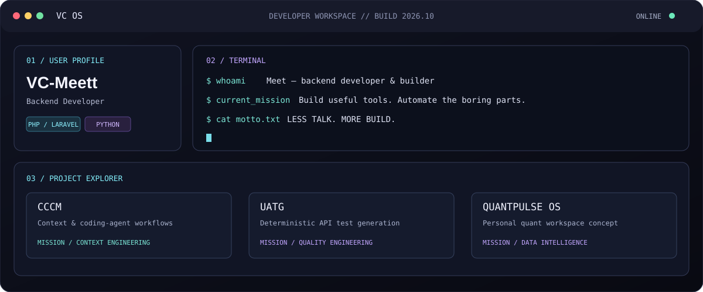

[PROFILE](https://github.com/VC-Meett) · [PROJECTS](#mission-control) · [GALAXY](#contribution-galaxy)

## VC OS // DEVELOPER WORKSPACE

A personal workspace for building useful tools, automating the boring parts, and learning by shipping.

## MISSION CONTROL

| Mission | Objective | Explore |
|---|---|---|
| **CCCM** | Context and session tooling for coding-agent workflows. | [Repositories](https://github.com/VC-Meett?tab=repositories) |
| **UATG** | Deterministic API test generation for Laravel applications. | [Repositories](https://github.com/VC-Meett?tab=repositories) |
| **QuantPulse OS** | A personal trading-intelligence workspace concept. | [Repositories](https://github.com/VC-Meett?tab=repositories) |

## CONTRIBUTION GALAXY

The galaxy is currently a visual concept, not a live data visualization. It can later be connected to actual contribution counts and regenerated automatically.

## TECH STACK // LOADED

## SYSTEM TELEMETRY

while (alive) { learn(); build(); repeat(); }

**SYSTEM ONLINE. NEXT MISSION LOADING...**

